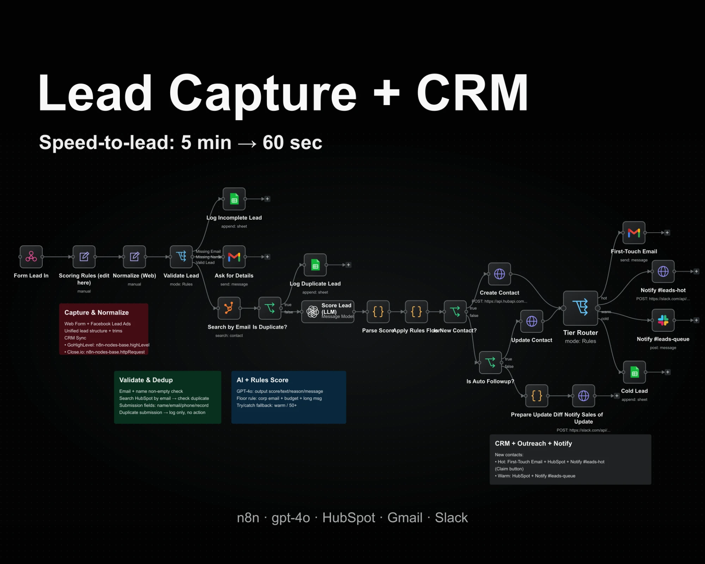

# Lead Capture + CRM (n8n)

Speed-to-lead: 5 min → 60 sec. An n8n workflow that captures web form leads, validates and de-duplicates them against HubSpot, scores them with GPT-4o plus rule-based floors, then routes hot / warm / cold leads to Gmail, Slack and Google Sheets.



> This is a **demo workflow**: every node that needs an account uses mock credentials and pinned mock data. Nothing calls a real API.

## Flow

1. **Capture & Normalize** – Webhook → scoring rules (Set) → normalize fields
2. **Validate & Dedup** – missing email → log to Sheets; missing name → ask via Gmail; valid → search HubSpot, duplicates logged to Sheets
3. **AI + Rules Score** – OpenAI (gpt-4o) score → parse with try/catch fallback (warm / 50) → floor rule (corp email + budget + long message)
4. **CRM + Outreach + Notify** – create / update HubSpot contact → Tier Router:
   - hot → First-touch email (Gmail) + Slack `#leads-hot` with Claim button
   - warm → Slack `#leads-queue`
   - cold → Google Sheets

## Files

| File | Purpose |
|---|---|
| `lead-capture-crm.json` | The n8n workflow, ready to import |
| `mock-credentials.json` | Fake credentials (no real secrets) so service nodes show no warnings |
| `build_workflow.py` | Generator that produces both JSON files |

## Run locally

```bash
docker run -d --name n8n -p 5678:5678 -v n8n_data:/home/node/.n8n n8nio/n8n:latest
```

Open http://localhost:5678, create the owner account, then:

```bash
docker cp mock-credentials.json n8n:/tmp/creds.json
docker cp lead-capture-crm.json n8n:/tmp/wf.json
docker exec n8n n8n import:credentials --input=/tmp/creds.json
docker exec n8n n8n import:workflow --input=/tmp/wf.json
```

Or import `lead-capture-crm.json` from the n8n UI (*Workflows → Import from File*) and create the credentials yourself.

To regenerate the JSON after editing the generator:

```bash
python3 build_workflow.py
```
