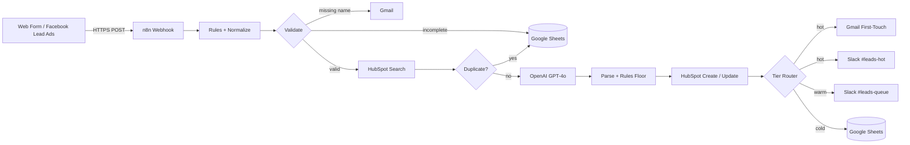

# Lead Capture + CRM Automation

> Version: v1.0.0<br>
> Author: MarcZhang

Lead Capture + CRM is an n8n automation that turns every inbound lead into a qualified, CRM-synced, sales-ready opportunity in under a minute. It captures web form and ad submissions, validates and de-duplicates them against HubSpot, scores each lead with GPT-4o backed by deterministic business rules, and routes it to the right follow-up channel across Gmail, Slack and Google Sheets.

**Speed-to-lead: 5 minutes → 60 seconds.**

## Architecture



The workflow runs as a single event-driven pipeline in four stages. Each stage narrows the set of leads that continue and hands a clean, enriched item to the next one:

| Stage | Input | Output | Integrations |
| --- | --- | --- | --- |
| 1. Capture & Normalize | Raw form / ad payload | One unified lead object | Webhook |
| 2. Validate & Dedup | Unified lead | Complete, non-duplicate leads | HubSpot, Gmail, Google Sheets |
| 3. AI + Rules Score | Valid lead | `score` (0-100) and `tier` (hot / warm / cold) | OpenAI |
| 4. CRM + Outreach + Notify | Scored lead | CRM record, outreach email, team alert | HubSpot, Gmail, Slack, Google Sheets |

Key design decisions:

- **Centralised configuration.** All thresholds live in one *Scoring Rules* node, so sales ops can tune qualification without touching logic.
- **LLM is advisory, rules are the floor.** GPT-4o captures intent and urgency; a deterministic floor guarantees that a strong lead (corporate domain + budget + detailed request) is never downgraded by a poor generation.
- **Fail soft.** If the model response cannot be parsed, the lead falls back to `warm / 50` and still reaches a human.
- **Dedup before scoring.** Duplicates are filtered before the LLM call to save tokens and prevent double notifications.
- **No silent drops.** Incomplete, duplicate and cold leads are all written to Google Sheets for audit and nurturing.
- **Raw API where control matters.** HubSpot contact writes and Slack Block Kit messages (with the *Claim* button) use HTTP Request nodes for full control over the payload.

## Project structure

```text
.
├── lead-capture-crm.json      # n8n workflow export, ready to import
├── credentials.example.json   # Credential templates for Gmail, Sheets, HubSpot, OpenAI, Slack
├── build_workflow.py          # Workflow-as-code generator for both JSON files
└── docs/
    └── reference.webp         # Workflow canvas overview
```

The workflow is defined as code in `build_workflow.py`. Node parameters, connections, layout and credential bindings are generated from one source, which keeps changes reviewable in Git instead of hidden in the n8n editor.

## Workflow nodes and components

### Stage 1 · Capture & Normalize

| Node | n8n node | Purpose |
| --- | --- | --- |
| Form Lead In | Webhook (`POST /lead-in`) | Entry point for website form and Facebook Lead Ads submissions |
| Scoring Rules (edit here) | Set | Central configuration: `hotThreshold` 80, `warmThreshold` 50, `corpEmailFloor` 50, `budgetFloor` 10,000, `longMessageChars` 80 |
| Normalize (Web) | Set | Maps every source into one schema (`name`, `email`, `phone`, `company`, `budget`, `message`, `source`); trims values, lower-cases email, casts budget |

### Stage 2 · Validate & Dedup

| Node | n8n node | Purpose |
| --- | --- | --- |
| Validate Lead | Switch (Rules) | Routes into *Missing Email*, *Missing Name* and *Valid Lead* |
| Log Incomplete Lead | Google Sheets – Append | Records uncontactable submissions in the `Incomplete` sheet for manual review |
| Ask for Details | Gmail – Send | Replies to leads without a name and asks for the missing details |
| Search by Email | HubSpot – Contact Search | Looks up the email to find an existing contact and its history |
| Is Duplicate? | IF | Detects repeated submissions within a short window |
| Log Duplicate Lead | Google Sheets – Append | Logs duplicates only: no CRM change, no email, no alert |

### Stage 3 · AI + Rules Score

| Node | n8n node | Purpose |
| --- | --- | --- |
| Score Lead (LLM) | OpenAI – Message a Model (`gpt-4o`) | Qualifies the lead and returns JSON: `score`, `tier`, `reason` and a drafted first-touch `message` |
| Parse Score | Code | Parses the model output inside try/catch with a `warm / 50` fallback and merges it onto the lead |
| Apply Rules Floor | Code | Applies the corporate-email + budget + message-length floor, then derives the final `tier` from the thresholds |

### Stage 4 · CRM + Outreach + Notify

| Node | n8n node | Purpose |
| --- | --- | --- |
| Is New Contact? | IF | Branches on whether HubSpot returned an existing contact |
| Create Contact | HTTP Request – `POST /crm/v3/objects/contacts` | Creates the HubSpot contact with lead status `NEW` and `lead_score` |
| Is Auto Followup? | IF | For existing contacts: continues automation only while the lifecycle stage is still `lead` |
| Update Contact | HTTP Request – `PATCH /crm/v3/objects/contacts/{id}` | Refreshes `lead_score` and lead status on the existing record |
| Prepare Update Diff | Code | For rep-owned contacts: builds a readable diff of changed fields (e.g. `phone: old → new`) |
| Notify Sales of Update | HTTP Request – Slack `chat.postMessage` | Sends the diff to `#leads-updates` so the owning rep is informed without automated outreach |
| Tier Router | Switch (Rules) | Routes by final tier into *hot*, *warm* and *cold* |
| First-Touch Email | Gmail – Send | Hot leads: sends the personalised GPT-4o email immediately |
| Notify #leads-hot | HTTP Request – Slack `chat.postMessage` | Hot leads: posts an alert with a Block Kit *Claim* button so the first available rep takes ownership |
| Notify #leads-queue | Slack – Send Message | Warm leads: posts to the shared queue for same-day follow-up |
| Cold Lead | Google Sheets – Append | Cold leads: archived in the `Cold` sheet for nurture campaigns |

Colour-coded sticky notes on the canvas label each stage and document alternative CRM targets (GoHighLevel via `n8n-nodes-base.highLevel`, Close.io via `httpRequest`).

## Workflow screenshot


## Integrations

| Service | Used for | n8n credential type |
| --- | --- | --- |
| Webhook | Lead intake from forms and ad platforms | – |
| OpenAI (GPT-4o) | Lead qualification and first-touch copy | `openAiApi` |
| HubSpot | Contact search, create and update | `hubspotAppToken` |
| Gmail | Detail requests and first-touch emails | `gmailOAuth2` |
| Slack | Hot-lead alerts, warm queue, update notices | `slackApi` |
| Google Sheets | Incomplete, duplicate and cold-lead logs | `googleSheetsOAuth2Api` |

## Local development

Python 3.9 or newer is required to regenerate the workflow.

```bash
python3 build_workflow.py
```

This writes `lead-capture-crm.json` and `credentials.example.json`. Edit thresholds, prompts, channels or sheet names in `build_workflow.py`, regenerate, then re-import.

## Docker deployment

1. Start n8n:

   ```bash
   docker run -d --name n8n -p 5678:5678 \
     -e GENERIC_TIMEZONE=Asia/Shanghai \
     -v n8n_data:/home/node/.n8n n8nio/n8n:latest
   ```

2. Open `http://localhost:5678` and create the owner account.

3. Import the credential templates and the workflow:

   ```bash
   docker cp credentials.example.json n8n:/tmp/creds.json
   docker cp lead-capture-crm.json n8n:/tmp/wf.json
   docker exec n8n n8n import:credentials --input=/tmp/creds.json
   docker exec n8n n8n import:workflow --input=/tmp/wf.json
   ```

4. In **Credentials**, fill in your OpenAI key, HubSpot private app token and Slack bot token, and connect the Gmail and Google Sheets OAuth apps.

5. Set your Google Sheet ID in the three Sheets nodes and your Slack channels in the notify nodes, then activate the workflow.

6. Point your form or Facebook Lead Ads forwarder at the production webhook URL:

   ```text
   https://<your-n8n-host>/webhook/lead-in
   ```

The workflow can also be imported from the n8n UI via *Workflows → Import from File*.

## Operations

```bash
# View n8n logs
docker logs -f n8n

# Re-import after regenerating the workflow
docker cp lead-capture-crm.json n8n:/tmp/wf.json
docker exec n8n n8n import:workflow --input=/tmp/wf.json

# Export the live version back to Git
docker exec n8n n8n export:workflow --id=LeadCaptureCRM01 --output=/tmp/wf.json
docker cp n8n:/tmp/wf.json lead-capture-crm.json

# Stop n8n without deleting data
docker stop n8n
```

Workflows, credentials and execution history are stored in the named `n8n_data` volume. Do not remove the volume unless the data is intentionally being deleted.

## Security notes

- Never commit real API keys, OAuth secrets or tokens; `credentials.example.json` contains placeholders only.
- Use HubSpot private app tokens and Slack bot tokens with the minimum required scopes.
- Run n8n behind HTTPS and set `N8N_ENCRYPTION_KEY` explicitly so credentials survive container rebuilds.
- Protect the webhook with header authentication or a shared secret when exposing it publicly.
- Back up the `n8n_data` volume before upgrading n8n.

## Author

Designed and developed by **MarcZhang**.
